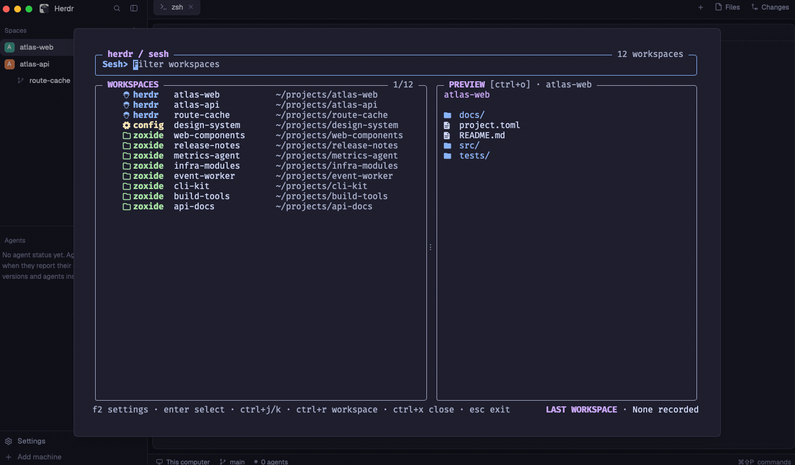

# Sesh

Find a Herdr space by typing part of its name, inspect its directory or terminal, and switch to it. The picker floats over the current space. A second shortcut takes you straight back to the previous space.



## What you see

The centered dialog uses 80.5% of the window width and 86.25% of its height. In the native picker, a filter and result count sit above a workspace list and a preview of the highlighted row. The list shows each entry's source, name and path. The footer shows shortcuts and the last workspace. The screenshot shows the dark terminal palette, monospace text and side-by-side preview. Narrow terminals stack the preview below the list.

## How it behaves

- Cmd+K opens the picker. Type to filter local and remote spaces, configured sessions and zoxide directories. Use the arrow keys to move, Enter or a row click to select, and Escape to cancel. Selecting an open space focuses it. Selecting a new target creates its space.
- In the native picker, Ctrl+O switches between directory and pane previews by default. Drag the divider to resize a side-by-side preview. The picker supplies the rendering and input handling, including agent sorting. Neither launcher draws an agent-status indicator.
- Cmd+semicolon switches to the most recent other space in Sesh history that is still open. Press it again to toggle back. If there is no previous space, an error notification explains why.

## Built from

- Two gpui-kit views, each with a manifest declaring `place: "none"` and a frameless 1×1 popup. Both render an empty div. The visible picker is the existing **herdr-sesh** terminal program.
- In `mods/sesh/`, use `exec` and `/bin/sh` to resolve the binary and login PATH. Use `hc ls` and `hc kill` to clean up terminals labelled `sesh=picker`. Start a background, auto-removed, parentless terminal in `home()` with that label. Run the resolved binary with the login PATH, `HERDR_SESH_BACKEND=app` and argument `picker`. Close the launcher via `props().overlay` **before** opening the modal terminal block so the dialog receives keystrokes. On a launch error, notify the user and clean up any terminal just created.
- In `mods/sesh-last/`, an overlay invocation runs `herdr-sesh last` through the same app backend and closes. An optional layout block instead monitors the active ID in `spaces()` every 100 ms, serializes `herdr-sesh app record-switch FROM TO` calls after a switch settles for 500 ms, and listens for the `last` command via `nextCommand()`.
- Install both runtime folders under the app home's `mods/`. Merge the two global bindings from `keys.json` into existing bindings, resolving any conflicts with the user. The recipe and screenshot stay in the package.

## Watch out

- Install this project's CLI on the login PATH alongside `herdr-app` and `hc`. Both launchers need `/bin/sh`. Opening the picker can run programs and access files outside the mod folder. The CLI reads Sesh configuration and history, lists directories, reads pane previews, and can run configured preview and workspace startup commands. Remote previews and configured remote workspaces use the registered machine through herdr-core.
- Closing the dialog externally can leave its terminal running. Opening the picker again cleans it up. A nonzero picker exit leaves its error visible until Enter.
- By default, last-space history covers switches made through Sesh. To record sidebar navigation, use a personal layout. If you use the built-in `main` layout, clone it first:

  ```sh
  herdr-app do layout.clone '{"name":"main","as":"my-layout"}'
  ```

  In `layouts/my-layout.json` under the app home (normally `~/.config/herdr-app`), append this block to the root's `children` array. If you already use a personal layout, edit its file instead. The block records only while its layout is active, skipping spaces shown for less than half a second.

  ```json
  { "id": "sesh-last", "type": "block", "size": { "px": 0 }, "content": { "mod": "sesh-last" } }
  ```

## Done when

- From the package folder, both `herdr-app check mods/sesh` and `herdr-app check mods/sesh-last` pass.
- Cmd+K opens a focused picker. Typing filters immediately, and Escape dismisses it with the original space still selected.
- With two open spaces, select the other one in the picker. Cmd+semicolon returns to the first, and a second press switches back.
- If the active layout includes the optional recorder block, verify a sidebar switch after the two-space toggle:
  1. Read `workspaces` in `${XDG_STATE_HOME:-$HOME/.local/state}/herdr-sesh/herdr-app/history.json`. Its first two IDs should be the current space followed by the other space. Use `herdr-app ls` to match IDs to names.
  2. Click the other space in the sidebar. Recheck the file for up to five seconds. The check fails unless those IDs reverse, with the clicked space first and the space you left second.
  3. Once history shows the switch, press Cmd+semicolon and verify that it returns to the space you left.
